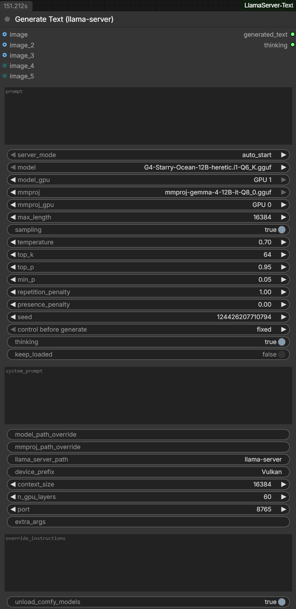

# ComfyUI-LlamaServer-Text

Run any **GGUF** language or vision model inside ComfyUI through llama.cpp's `llama-server`.

ComfyUI's native *Generate Text* node only works with text encoders that ComfyUI loads itself.
This node starts `llama-server` for you, sends your prompt (and up to 5 images), streams the answer
back, and shuts the server down so the VRAM is free again for the rest of your workflow.

Typical uses: prompt writing/expansion, image-to-prompt, captioning, anything that needs a local LLM or VLM
in the middle of a generation workflow.

<p align="center">
  
</p>

## Features

- **Any GGUF your llama.cpp build supports**, text-only or vision (with its `mmproj` file).
- **Dropdowns instead of paths**: models and mmproj files are discovered automatically
  (see [Where models are looked up](#where-models-are-looked-up)).
- **Up to 5 image inputs.** With two or more images the prompt gets `Image 1:`, `Image 2:` ... labels, so you can
  write things like "take the hair from Image 2".
- **Multi-GPU placement**: put the model on one GPU and the vision projector on another GPU (or on the CPU).
- **VRAM-friendly**: the server is started for each run and stopped afterwards (unless `keep_loaded` is on),
  ComfyUI's own models are unloaded first so the two do not pile up in VRAM, and leftover servers from crashed
  runs are cleaned up.
- **Progress and cancel**: a per-token progress bar in the UI and the console (with tokens/s); the cancel button
  stops generation in the middle of an answer.
- **`override_instructions`** field: extra instructions that win over the system prompt, the prompt and what is
  visible in the images (for example *"ignore the text on the sign"* or *"make the hair red"*).
- **Local only**: the server listens on `127.0.0.1` and nothing is sent anywhere else.

## Requirements

- **ComfyUI** (a recent version). The node needs no extra Python packages: it only uses what ComfyUI already ships.
- **llama.cpp's `llama-server`**, a recent build. Download a release from
  <https://github.com/ggml-org/llama.cpp/releases> that matches your hardware (CUDA, Vulkan, HIP, Metal or CPU).
  New model families need recent builds, and the per-GPU choice for vision (`--mmproj-device`) needs a recent one too.
- **A GGUF model file**, plus its **mmproj** file if you want to send images.
- Enough VRAM/RAM for the model and its context.
- A free local port (default `8765`).
- **OS**: developed and tested on **Windows** with a Vulkan build of llama.cpp and two GPUs. The Linux and macOS
  code paths exist but have only been exercised against a simulated server, so reports from real machines are welcome.

## Installation

```
cd ComfyUI/custom_nodes
git clone https://github.com/Skol600ml/ComfyUI-LlamaServer-Text
```

Restart ComfyUI. The node appears under **utils > LLM > Generate Text (llama-server)**.

## Quick start

1. Make sure `llama-server` runs: either it is on your `PATH`, or put its full path in the node's
   `llama_server_path` (for example `C:\llama\llama-server.exe`).
2. Copy your `.gguf` file(s) to `ComfyUI/models/text_encoders/` (or `ComfyUI/models/LLM/`), then press **R** in
   ComfyUI to refresh the lists.
3. Add the node, pick the **model**, write a **prompt**, and run.
4. For images: connect an `IMAGE` to `image`, and pick the matching **mmproj** (the file from the same model family).

## Example workflow

A sample of the node used inside a larger workflow (screenshot):


## Where models are looked up

The `model` and `mmproj` lists are built from these folders (subfolders included). Files with `mmproj` in their name
go to the mmproj list, every other `.gguf` goes to the model list.

- ComfyUI's `text_encoders` and `clip` folders (this includes folders added in `extra_model_paths.yaml`)
- `ComfyUI/models/LLM`
- Folders in the `LLAMA_GGUF_DIRS` environment variable (separated by `;` on Windows, `:` elsewhere)
- Folders listed in `EXTRA_MODEL_DIRS` at the top of `llama_server_text.py`

You can also bypass the lists with `model_path_override` and `mmproj_path_override`.

## GPU selection

Run `llama-server --list-devices` to see the names your build uses, for example `CUDA0`, `CUDA1` or `Vulkan0`.

- `device_prefix`: the name without the number (`CUDA`, `Vulkan`, ...). The default is `CUDA`.
- `model_gpu`: `all GPUs` (llama.cpp default, splits across every GPU), `GPU 0` or `GPU 1`.
- `mmproj_gpu`: `same as model`, `GPU 0`, `GPU 1` or `CPU`.

Need another GPU number? Leave `model_gpu` on `all GPUs` and add `--device CUDA2` (or similar) to `extra_args`.

## VRAM behavior

- `keep_loaded` **off** (default): the server is started for each run and stopped right after, so the model leaves
  VRAM before the next node runs. `keep_loaded` **on**: the server stays up between runs (faster for repeated runs,
  but the VRAM stays used). It is stopped when ComfyUI exits.
- `unload_comfy_models` **on** (default): before a new server starts, the node unloads the models ComfyUI kept in
  VRAM from the previous generation (the same as the *Unload Models* button). `llama-server` is a separate process, so
  ComfyUI would not do this on its own, and the two would otherwise stack up.
- If ComfyUI dies, the server does not stay behind: on Windows it is attached to a job object, and on every
  platform the node cleans up orphaned servers it started on the next run.
- `n_gpu_layers` (default 99 = everything on the GPU) and `context_size` (default 8192) control memory use. The context
  must hold the system prompt, the prompt, the image tokens and `max_length`.

## Inputs

**Required**

| Input | Default | What it does |
|---|---|---|
| `prompt` | | The user message. |
| `server_mode` | `auto_start` | `auto_start` runs `llama-server` for you; `external_server` uses one you started yourself on `port`. |
| `model` | | GGUF file from the list. |
| `model_gpu` | `all GPUs` | Which GPU the model runs on. |
| `mmproj` | `none` | Vision projector file. Only loaded when an image is connected. |
| `mmproj_gpu` | `same as model` | Where the vision projector runs. |
| `max_length` | 4096 | Maximum number of new tokens. |
| `sampling` | on | Off = greedy decoding (deterministic). |
| `temperature`, `top_k`, `top_p`, `min_p` | 0.7, 64, 0.95, 0.05 | Sampling controls (used when `sampling` is on). |
| `repetition_penalty`, `presence_penalty` | 1.0, 0.0 | Repetition controls. |
| `seed` | 0 | Sampling seed. |
| `thinking` | off | Passes `enable_thinking` to the model's chat template (only has an effect on models that support it). |
| `keep_loaded` | off | Keep the server running after the node finishes. |

**Optional**

| Input | Default | What it does |
|---|---|---|
| `system_prompt` | | System message. |
| `image`, `image_2` ... `image_5` | | Images for vision models, one image per input (if an input carries a batch, only the first image is used). Images are downscaled to at most 1280 px on the long side. |
| `model_path_override`, `mmproj_path_override` | | Full paths that win over the dropdowns. |
| `llama_server_path` | `llama-server` | Path to the executable. |
| `device_prefix` | `CUDA` | Device name prefix used for GPU selection. |
| `context_size` | 8192 | Context length (`-c`). |
| `n_gpu_layers` | 99 | Layers offloaded to the GPU (`-ngl`). |
| `port` | 8765 | Local port. |
| `extra_args` | | Extra command line arguments passed to `llama-server`. |
| `override_instructions` | | Instructions that override everything else when they conflict. |
| `unload_comfy_models` | on | See [VRAM behavior](#vram-behavior). |

**Outputs**: `generated_text` and `thinking` (the reasoning text, when the model produces one).

The chat template comes from the GGUF file itself (`llama-server` runs with `--jinja`).

## Troubleshooting

| Problem | What to try |
|---|---|
| *llama-server exited during startup* | The error shows the end of the log; the full log is `llama_server_<port>.log` in the node folder. Common causes: an old llama.cpp that does not know the model architecture (update it), not enough memory (lower `context_size` or `n_gpu_layers`, or use a smaller quantization), or an invalid device name (check `llama-server --list-devices` and `device_prefix`). |
| *Could not find the executable* | Put the full path to `llama-server` in `llama_server_path`. |
| *A llama-server is already responding on port ...* | Another process (often an orphan from a crash) is using the port. Close it (`taskkill /F /IM llama-server.exe /T` on Windows, `pkill -f llama-server` elsewhere) or change `port`. |
| *An image is connected, but no valid mmproj was selected* | Pick the mmproj that belongs to your model, or disconnect the image. |
| The model list shows *(no .gguf files found)* | Put files in one of the [folders above](#where-models-are-looked-up) and press **R**. |
| The answer is cut off | Raise `max_length` and, if needed, `context_size`. |
| VRAM is still high after a run | Make sure `keep_loaded` is off and `unload_comfy_models` is on. If it persists, check whether a stray `llama-server` process exists. |

## Security notes

- The server binds to `127.0.0.1` only.
- A workflow file can set `llama_server_path` and `extra_args`. The node only accepts executables whose file name
  contains `llama` (or is `server`), and it never runs anything through a shell, but as with any shared workflow you
  should look at those two fields before running a workflow from someone you do not know.

## Limitations

- No audio or video input; images only.
- One image per image input.
- `thinking` only matters for models whose chat template supports it.

## License

MIT, see [LICENSE](LICENSE).

## Credits

Built on [llama.cpp](https://github.com/ggml-org/llama.cpp) by the ggml-org contributors.
